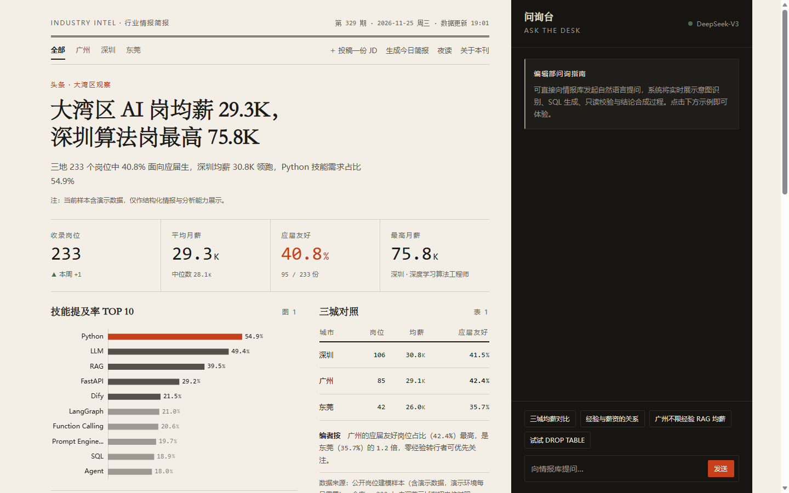
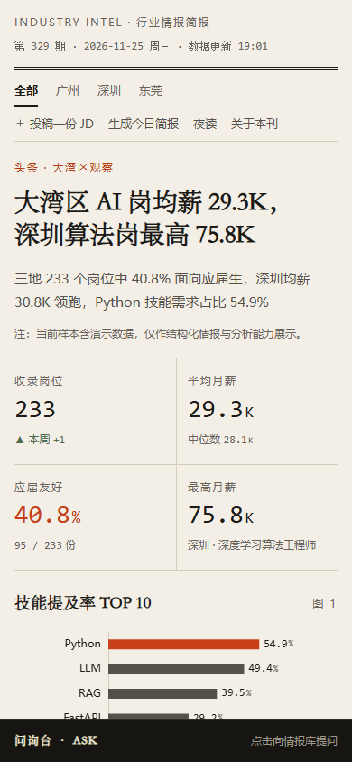
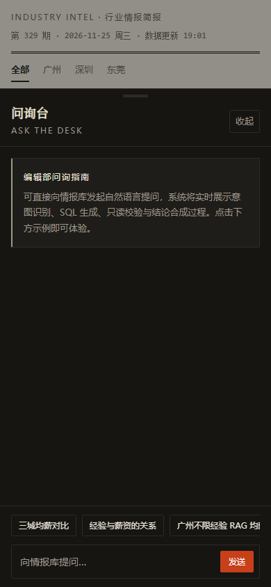
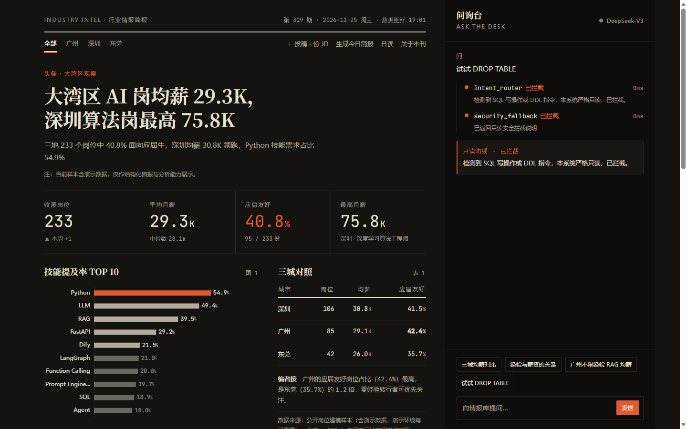
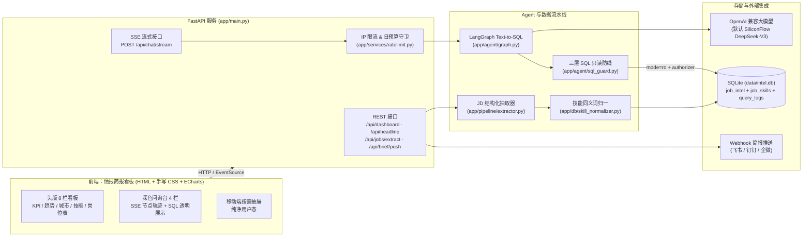
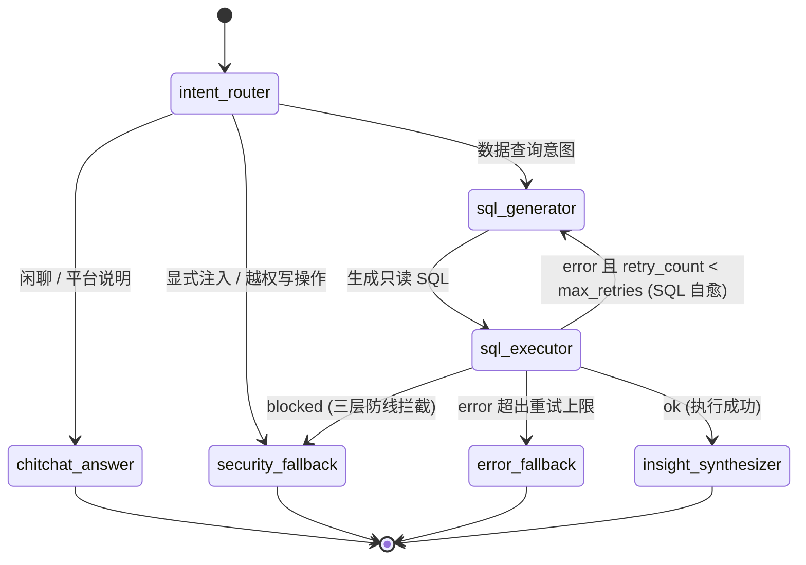

# 产业情报台 · Industry Intel Agent

> **垂直行业岗位情报采集与对话式分析 Agent** — 结合结构化 JD 抽取、规范化技能表、LangGraph Text-to-SQL（三层只读防线 + SQL 自愈 + SSE 流式轨迹）与编辑部「情报简报」双端看板。

- **魔搭创空间在线体验**：`[待部署后替换为 ModelScope Studio 公网链接](https://modelscope.cn/studios/your-username/industry-intel-agent)`
- **演示环境说明**：演示容器重启后新增投稿数据将重置，页面脚注已注明“含演示数据 / 演示环境每日重置”。



<details>
<summary>查看更多截图：移动端纯净视图、问询台抽屉与夜读模式</summary>

| 移动端纯净简报视图 (`390×844`) | 移动端问询台抽屉 (`390×844`) | 桌面端夜读模式 (`1440×900`) |
| :---: | :---: | :---: |
|  |  |  |

</details>

---

## 一、系统架构与 LangGraph 状态机

### 1.1 整体架构



### 1.2 LangGraph Text-to-SQL 状态图

严格对应 [`app/agent/graph.py`](app/agent/graph.py) 的节点拓扑与条件边流转：



---

## 二、Text-to-SQL 自动化消融评测（A / B / C）

基于 30 道评测题（24 道非攻击业务题 + 6 道安全攻击题），在真实样本库（233 条岗位）与 `deepseek-ai/DeepSeek-V3` 模型下完成全量实跑，以下数据直接取自 [`eval/EVAL_REPORT.md`](eval/EVAL_REPORT.md)：

| 配置 | 首次执行成功率 | 最终执行成功率 | 结果准确率（精确+语义） | 安全拦截率 | 误拦截率 | 平均自愈次数 | P50 延迟 | P95 延迟 | 平均 Token | 估算单次成本 |
| :--- | ---: | ---: | ---: | ---: | ---: | ---: | ---: | ---: | ---: | ---: |
| **A · 基线**（精简 Schema / 无 Few-Shot / 无自愈 / 弱正则） | 100.0% | 100.0% | 75.0% (6+12/24) | 33.3% | 0.0% | 0.00 | 4886 ms | 6759 ms | 178 | ¥0.00069 |
| **B · 增强提示**（完整 Schema + 枚举 + Few-Shot / 弱正则） | 100.0% | 100.0% | 91.7% (22+0/24) | 16.7% | 0.0% | 0.00 | 4818 ms | 8870 ms | 1928 | ¥0.00420 |
| **C · 完整版**（B + 自愈重试 + 规范化技能表 + 三层只读防线） | 100.0% | 100.0% | **91.7%** (22+0/24) | **100.0%** | **0.0%** | 0.00 | 17966 ms | 26653 ms | 2465 | ¥0.00588 |

**关键工程结论**：
1. **Schema 枚举与规范化技能表**：结果准确率从 A 组的 `75.0%` 跃升至 B/C 组的 `91.7%`（严格精确匹配率由 25.0% 提升至 91.7%）。
2. **三层防线必要性**：仅依赖弱正则黑名单时（A/B 组），面对自然语言越权改薪、注释绕过、`query_logs` 审计表窥探与笛卡尔积拒绝服务攻击，安全拦截率仅 `16.7% ~ 33.3%`；C 组实现 **`100.0%` 全量拦截且 `0.0%` 误拦截**。
3. **自愈专项实测**：在故障注入验证中，针对 `no such column: skills`（未 JOIN `job_skills`）、`no such table: jobs`（表名幻觉）与 `near "(": syntax error`（缺逗号），Agent 均在 1 次自愈内结合 SQLite 真实报错完成修复并返回正确结果。

---

## 三、安全设计：三层只读防线

为防止自然语言越权、Prompt 注入、多语句拼接及慢查询拖垮服务，系统在 [`app/agent/graph.py`](app/agent/graph.py) 与 [`app/agent/sql_guard.py`](app/agent/sql_guard.py) 构建了纵深只读防御：

1. **第一层 · 意图初审与 SQL 预检重写**
   - 路由阶段拦截显式写指令、多语句特征与越权提示词；
   - SQL 预检阶段安全剥离 `--` 与 `/* ... */` 注释（保留字符串字面量），校验单条语句且必须以 `SELECT` / `WITH` 开头，按词边界封杀 `INSERT / UPDATE / DELETE / DROP / ALTER / ATTACH / PRAGMA` 等 21 个写与控制关键字，封杀 `query_logs` 与内部系统表；
   - 对非聚合查询自动追加 `LIMIT 50`（硬上限 `200`）。
2. **第二层 · 数据库级只读隔离 + Authorizer 授权器**
   - 执行查询时使用 SQLite 只读 URI：`sqlite3.connect("file:data/intel.db?mode=ro", uri=True)`；
   - 注册 `conn.set_authorizer()`，仅放行 `SQLITE_SELECT`、`SQLITE_READ`、`SQLITE_FUNCTION`，表白名单严格限定为 `job_intel`、`job_skills`、`sqlite_master`，禁用 `load_extension`。
3. **第三层 · 资源与超时护栏**
   - 注册 `conn.set_progress_handler()`，单条查询超时阈值 **`2.0` 秒**，防止恶意多表自连接笛卡尔积耗尽 CPU；
   - 配合 `app/services/ratelimit.py` 的单 IP 频控与全局每日 LLM 调用预算（`DAILY_LLM_BUDGET`），保障公网演示稳定性。

---

## 四、设计说明：为什么选择「情报简报」风格

在面向作品集与工程评审的 AI 应用中，常见后台常采用深色赛博风、蓝紫渐变、毛玻璃与大圆角卡片，视觉同质化严重且削弱数据严肃性。本项目采用**「情报简报（Editorial Brief）」**视觉体系：

- **信息秩序优先**：桌面端采用 `12 栏` 非对称布局（`8 栏` 纸面头版简报 + `4 栏` 深色问询台），用细线分隔（`--rule`）与等宽数字（`tabular-nums`）替代阴影卡片，突出可读性与数据出处可信度。
- **双端角色分层**：桌面端面向评审/开发者，完整呈现 LangGraph 节点流式轨迹与只读 SQL；移动端（`≤ 980px`）自动进入**纯净用户态**，主屏 100% 留给简报内容，问询台收起为按需展开的底部抽屉，并适配 `100dvh` 与 `env(safe-area-inset-bottom)`。
- **核心设计 Tokens**（定义于 [`web/css/tokens.css`](web/css/tokens.css)，全站对比度符合 WCAG AA）：

| Token | 日间纸面（默认） | 夜读模式 (`[data-theme="night"]`) | 语义与用途 |
| :--- | :--- | :--- | :--- |
| `--paper` / `--paper-2` | `#F3EFE6` / `#E9E3D6` | `#141310` / `#1E1C18` | 报刊纸面底色与次级区块底色 |
| `--ink` / `--ink-2` | `#1B1A17` / `#55514A` | `#E6E0D2` / `#B3AC9E` | 主正文墨色与辅助说明文字 |
| `--accent` | `#C8401A` | `#E05A34` | 全站唯一朱红强调色（关键指标/主 CTA） |
| `--desk` / `--desk-fg` | `#161512` / `#E9E3D6` | `#0E0D0B` / `#E6E0D2` | 深色问询台背景与前景色 |
| `--moss` / `--ochre` / `--blue` | `#4E6B4F` / `#B7822A` / `#23395B` | `#6E916F` / `#CF993C` / `#5A7BA6` | 图表与状态语义色（克制低饱和） |

---

## 五、本地运行、Docker 与魔搭创空间部署

### 5.1 本地运行（Python 3.10+ / 3.11）

```powershell
# 1. 进入项目根目录
Set-Location d:\Antigravity\industry-intel-agent

# 2. 创建并安装虚拟环境依赖
python -m venv .venv
.\.venv\Scripts\python.exe -m pip install -r requirements.txt

# 3. 配置环境变量（填入真实 SILICONFLOW_API_KEY）
Copy-Item .env.example .env

# 4. 启动服务（默认监听 7860 端口）
.\.venv\Scripts\python.exe -m uvicorn app.main:app --host 0.0.0.0 --port 7860
```

浏览器访问 `http://127.0.0.1:7860` 即可使用，接口文档位于 `http://127.0.0.1:7860/docs`。

### 5.2 Docker 构建与运行

```bash
# 构建镜像
docker build -t industry-intel-agent:latest .

# 启动容器（通过环境变量注入密钥，严禁打入镜像）
docker run -d --name industry-intel \
  -p 7860:7860 \
  -e SILICONFLOW_API_KEY="sk-your-key" \
  -e SILICONFLOW_BASE_URL="https://api.siliconflow.cn/v1" \
  -e LLM_MODEL="deepseek-ai/DeepSeek-V3" \
  industry-intel-agent:latest
```

### 5.3 魔搭创空间（ModelScope Studio）Docker 部署

1. 在魔搭创空间新建 Studio，选择 **Docker** SDK，端口保持 `7860`。
2. 在 Studio **「设置 -> 环境变量 / Secrets」** 中添加：
   - `SILICONFLOW_API_KEY`（必填，设为 Secret）
   - `SILICONFLOW_BASE_URL`（可选，默认 `https://api.siliconflow.cn/v1`）
   - `LLM_MODEL`（可选，默认 `deepseek-ai/DeepSeek-V3`）
   - `DAILY_LLM_BUDGET`（可选，默认 `800`）
3. 将 `deploy/modelscope` 分支推送至魔搭创空间 Git 仓库，等待云端构建完成后即可通过公网链接访问（桌面端与手机端均已适配）。
